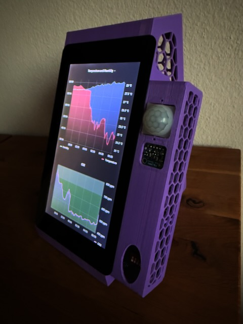
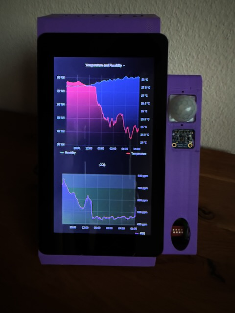
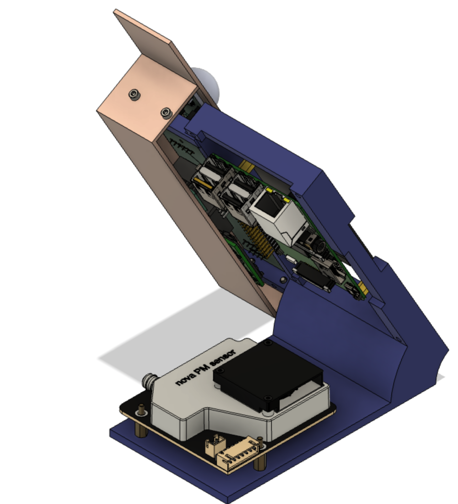

# Sensorstation

A Raspberry Pi environmental monitoring station that has been running continuously since 2022.
It measures CO₂, temperature, humidity, air pressure, light level and particulate matter, writes
everything to a local InfluxDB, and shows it on a Grafana dashboard on its own touch display.

Custom PCB, 3D-printed housing, and a row of DIP switches on the side so it can be handled
without a keyboard.



*The finished station on the shelf, showing the last few hours of temperature, humidity and CO₂.*

---

## What it measures

| Sensor | Bus | Measures |
|---|---|---|
| SCD30 | I²C | CO₂, temperature, humidity |
| BME280 | I²C | Temperature, humidity, air pressure |
| TSL2591 | I²C | Light level (lux) |
| SDS011 | USB serial | Particulate matter, PM2.5 and PM10 |
| DS3231 | I²C | Real-time clock, so the station keeps time without WiFi |

Readings go into InfluxDB on the Pi itself and are drawn in Grafana. Nothing leaves the flat.

---

## How it runs

**Once a minute, via cron:** `SCD30.py`, `BME280.py`, `TSL2591.py`
Each reads its sensor, writes one point to InfluxDB, and exits. The crontab is in `crontab.txt`.

**Daemons started at boot:**
- `SDS011.py` — reads the particulate sensor continuously over `/dev/ttyUSB0`
- `DipSwitch.py` — polls the four DIP switches
- `ScreenControl.py` — display backlight

**Daily:** `timesync.sh` brings WiFi up, syncs NTP, writes the time to the RTC, then puts WiFi back the way it found it.

### The DIP switches

Four switches on the side of the case, because reaching for SSH to turn off a dust sensor is silly:

| Switch | GPIO | Function |
|---|---|---|
| 1 | 27 | SDS011 particle sensor on/off |
| 2 | 17 | Unassigned |
| 3 | 4 | WiFi on/off |
| 4 | 24 | System shutdown |

### The screen

A PIR sensor (GPIO 22) plus the TSL2591 light reading decide when the DSI display wakes up.
Walk past in a lit room and it comes on for 60 seconds, then goes dark again. In the dark
(lux < 5) it stays off, so it doesn't light up the room at night.

Full pin assignment is in [`GPIO_PINOUT.md`](GPIO_PINOUT.md).

---

## Hardware

<p align="center">
  
  
</p>

*Left: the printed housing, PIR dome and CO₂ sensor on the side panel.
Right: the original Fusion 360 exploded view — the Nova PM (SDS011) sensor sits in the base,
the Pi and the custom HAT above it.*

```
hardware/
├── enclosure/    4 printable STLs: main body, side housing, side wall, stand
└── pcb/          EAGLE schematic + Gerbers (v12, April 2022)
```

The enclosure prints in four parts. The hex-pattern vents let air reach the sensors without
letting the light sensor see straight out.

Not included here: the Sensirion SCD30 driver, vendor datasheets, and third-party CAD models
for the Pi display and connectors — get those from the manufacturers.

---

## Dependencies

```
influxdb
adafruit-circuitpython-bme280
adafruit-circuitpython-tsl2591
adafruit-circuitpython-ds3231
scd30_i2c
gpiozero
rpi_backlight
pyserial
```

No build step, no virtualenv — the scripts run directly on the Pi.

---

## Notes

- All I²C sensors share GPIO 2 (SDA) and GPIO 3 (SCL).
- The DS3231 is claimed by the kernel at `0x68` and reached through `hwclock`, not Python.
- Station altitude is hardcoded to **435 m** in `BME280.py` for the sea-level pressure conversion —
  change that if you build one somewhere else.

Built for my own flat, and still running. Happy to answer questions if you're building something similar.
